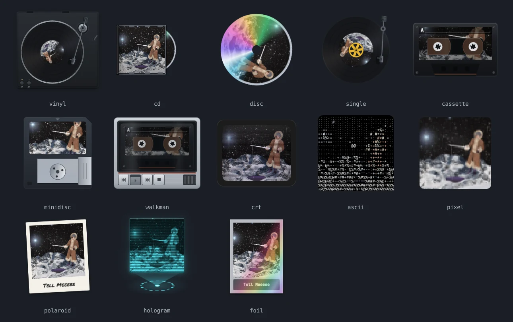

# NowSpinning

A floating MPRIS widget for Hyprland, built on Quickshell. Shows the current track as a spinning physical-media skin, a vinyl record, a CD, a cassette, a MiniDisc, a portable cassette player, a 7" single, or one of a few flat takes on the cover itself (an old CRT, ASCII art, pixel art, a Polaroid, a hologram, a foil trading card, a risograph print, a four-tone LCD, a stained glass window, a blueprint) or a cyberpunk one (a HUD panel, a data shard, a neon sign, a neon disc, digital rain, a terminal, a datamoshed video), or something with more style (a jazz session title card, a hard-bop record sleeve, an art deco frame, a gallery frame, a concert ticket, a magazine cover, a postage stamp, a gig poster pasted on a wall) or an anime one (an episode title card, a phantom thief's calling card), with transport controls a click away.



It's a player *client* only: it displays and controls whatever MPRIS player is already running. It doesn't play audio, manage a library, or handle a queue.

## Why

Just for fun, really. This is for anyone who likes seeing the cover art of whatever they're currently listening to, more than it's meant to be a serious tool. Spotify's own mini player is minimal, but not something nice to look at, and that's what actually pushed this into existing: something with actual presence instead of a flat progress bar. An object with weight and motion. Grooves that catch light, a tonearm that lifts and lowers, a CD that spins inside its case, all built to be easy to extend with new skins later.

## Requirements

- A Wayland compositor implementing `wlr-layer-shell`. Developed on Hyprland; see Compatibility.
- [`quickshell`](https://quickshell.org) 0.3.1 or newer. It pulls in Qt6 itself (base, declarative, wayland, svg), so there's nothing to install separately for that.
- `qt6-5compat`, for the `Qt5Compat.GraphicalEffects` import in `parts/Sheen.qml`. Quickshell doesn't depend on it, so on a clean system it won't already be there.
- An MPRIS-capable player. NowSpinning displays and controls whatever is already running; it doesn't play audio itself.
- Optional: [`cava`](https://github.com/karlstav/cava), for a progress wave that follows the music (`audioWave`) and skins that pulse with it (`audioReact`). Without it the wave is a plain sine and the skins keep their own pulse.

## Install

Whichever way you install it, you get the same `nowspinning` command: a toggle that starts the widget if it isn't running and kills it if it is, for a terminal or a Hyprland keybind, plus a desktop entry so it shows up by name and icon in your application menu and in launchers like rofi or wofi.

### As an Arch package

```sh
git clone https://github.com/AlejandroMinor/NowSpinning && cd NowSpinning/packaging/arch && makepkg -si
```

That builds the latest release and installs it with pacman, so `sudo pacman -R nowspinning` takes it out again. `cava` is an optional dependency; install it too for the audio wave.

### From source

```sh
sudo pacman -S --needed quickshell qt6-5compat cava
```

That's Arch; see quickshell.org for other distros. Then clone this repo and, from inside it, either install a copy or link to the clone.

**Install a copy:**

```sh
sudo make install
```

That goes under `/usr/local`. For your home directory instead, without `sudo`, use `make install PREFIX=~/.local`, with `~/.local/bin` on your PATH. The clone isn't needed afterwards; to update, `git pull` and `make install` again. `make uninstall`, with the same `PREFIX`, takes it all out.

**Or link to the clone**, which keeps the widget running straight out of the repo: a `git pull`, or an edit of your own, shows up without reinstalling, but the clone has to stay where it is. The toggle script finds the widget next to itself, back in the repo. The second link, the desktop entry, is optional.

```sh
mkdir -p ~/.local/bin && ln -sfn "$(pwd)/bin/nowspinning" ~/.local/bin/nowspinning
mkdir -p ~/.local/share/applications && ln -sfn "$(pwd)/desktop/nowspinning.desktop" ~/.local/share/applications/nowspinning.desktop
nowspinning
```

Or run it without the script: `qs -p ./nowspinning`. Set `NOWSPINNING_DIR` to point the `nowspinning` command at another copy of the widget.

To undo it, remove the two links; the clone itself is untouched, delete it too if you no longer want it:

```sh
rm ~/.local/bin/nowspinning ~/.local/share/applications/nowspinning.desktop
```

### Autostart

To start it with your session, add a line to your existing `hl.on("hyprland.start", ...)` block in your Lua config, the same way you'd autostart any other program:

```lua
hl.on("hyprland.start", function()
    -- ...whatever else you already autostart here...
    hl.exec_cmd("nowspinning")
end)
```

If you don't have that block yet, the whole thing is what goes in your config. On a plain `hyprland.conf` setup, the equivalent is `exec-once = nowspinning`.

Optionally, bind a key to `nowspinning` in your Hyprland keybindings for a manual toggle.

## Config

Lives at `~/.config/nowspinning/config.json`, reloaded live on save. See `config.example.json` for the full set of defaults. Set `NOWSPINNING_CONFIG_DIR` to read it from another folder instead, for a second launcher with its own look.

| Key | Default | Meaning |
|---|---|---|
| `skin` | `"cd"` | `"vinyl"`, `"cd"` (the disc in its jewel case), `"disc"` (the same CD on its own, no case), `"cassette"` (the tape winds from one reel to the other as the track plays), `"minidisc"` (the shutter slides open while playing, showing the disc spinning inside), `"walkman"` (the cassette inside a portable player, its play key pressed in while playing), `"crt"` (the cover on an old TV, with scanlines and a glitch every few seconds), `"ascii"` (the cover drawn in characters), `"pixel"` (the cover pixelated), `"polaroid"` (the cover as a photo with the title in marker; each new track drops a new one on top, and the last three fan out behind it), `"single"` (a 7" record with a 45 adapter in the cover's color), `"hologram"` (the cover projected in cyan from an emitter, with a signal dropout now and then), `"foil"` (the cover as a holographic trading card, the foil sliding across it), `"riso"` (the cover as a risograph print: halftone dots in fluorescent pink, blue and yellow, each ink out of register its own way, printed one ink at a time on each new track), `"lcd"` (the cover dithered to four shades on a dot-matrix LCD whose dots cast a shadow on the screen; a new cover darkens in over a ghost of the last), `"stainedglass"` (an arched window, its glass cut from the cover, finer where the cover has edges, held in lead; the light comes through where the sun is and casts the window's colours on the wall, and the sun follows the pointer), `"blueprint"` (the cover's contours and hatched shadows in white on blueprint blue, with the track's length as a dimension and a title block; plotted down the sheet on each new track, stamped ON HOLD when paused), `"hud"` (the cover in a yellow cyberpunk HUD panel, with a scan bar, a glitch now and then and the progress in segments), `"shard"` (the cover on a see-through data chip whose circuit traces pulse while playing), `"neon"` (the cover framed by a flickering pink neon tube, the title lit in cyan underneath), `"neondisc"` (a black disc with neon grooves and a breathing halo, the cover as its label), `"matrix"` (the cover, tinted green, behind falling katakana; under the pointer the rain thins and the cover comes through), `"terminal"` (a terminal window that types out `now-playing` on each track and prints the cover in a few green pixels, the title, the artist and a bar of hashes; under the pointer the command runs again), `"datamosh"` (a video that lost its keyframe: on each new track the old cover's pixels get dragged by the new one's motion, in blocks, until the new cover heals through; under the pointer the pixels drag along with it, and rows slip with the beat), `"session"` (a jazz-era title card: red, blue and mustard blocks sliding past the cover, a session number per track, and the end card when paused), `"sleeve"` (the cover in duotone on a hard-bop record sleeve, the artist in bold capitals; the record peeks out spinning while playing and slides further out under the pointer), `"deco"` (the cover in a black and gold art deco frame, its sunburst lighting up ray by ray), `"gallery"` (the cover hung in a thin black frame on a white mat, a brass plaque underneath, lit from above while playing; under the pointer the light follows it), `"ticket"` (a concert ticket with the cover, the artist and a red ADMIT ONE stub; an INTERMISSION stamp when paused, and the stub pulls away along the perforation under the pointer), `"magazine"` (the cover art on a music magazine under a NOW masthead, a new issue sliding in each track; its corner lifts under the pointer), `"stamp"` (a perforated postage stamp valued at the track's length in cents, postmarked PLAYED on each new track; it lifts off the page under the pointer), `"poster"` (a gig poster wheatpasted on a wall, wrinkled by the paste, in the cover's accent; each new track is pasted over the last, POSTPONED when paused, and its corner peels off under the pointer, showing the one underneath), `"episode"` (an anime episode title card, heavy white serif on black, cutting hard to the cover every few seconds; TO BE CONTINUED when paused), or `"phantom"` (a red and black calling card, the cover askew in high contrast and the title in ransom-note letters that drop in each track and twitch with the beat) |
| `discSize` | `"medium"` | `"small"` (120px), `"medium"` (170), `"large"` (220), or `"xl"` (280); an exact pixel size also works as a string, e.g. `"200"`. Everything else scales from this |
| `showArm` | `false` | Tonearm on the vinyl and 7" skins; the other skins ignore it |
| `showDeck` | `false` | Vinyl skin only: the turntable under the record, with platter, speed keys and cue lever. Makes the widget wider; pairs well with `showArm` |
| `spinDegreesPerSecond` | `9` | Rotation speed; `0` lets the skin pick its own (vinyl: 9, CD: 30, cassette and walkman: 40, for a reel holding half the tape; MiniDisc: 30) |
| `artFull` | `false` | Full-face cover art, on skins that support it |
| `progressStyle` | `"ring"` | `"ring"` around the disc, or `"bar"` inside the controls overlay (forced on square-faced skins) |
| `discOpacity` | `1.0` | Disc transparency, 0 to 1 |
| `dragGain` | `0.45` | How tightly dragging tracks the cursor where Hyprland's IPC isn't available; see Limitations |
| `shellOpacity` | `1` | Cassette and walkman skins only: how solid its plastic is. Lower it for a clear shell (around `0.45`): the desktop shows through, and so does the tape inside, running around the rollers. The label stays solid; `discOpacity` fades the whole widget instead |
| `tintFromArt` | `true` | Color the progress indicator, the volume bar, and the cassette's and MiniDisc's plastic with a color picked out of the cover art. Covers without much color in them stay white |
| `shadow` | `true` | A soft drop shadow under the widget, as if it sat a little above the desktop. Skins with a shadow of their own (the turntable, the foil card, the Polaroid) and the ones made of light (the hologram, the cyberpunk ones, which glow instead, and the stained glass, whose shadow is the coloured light it casts) leave it out |
| `audioReact` | `true` | The skins with a pulse of their own (the neon sign, the neon disc, the shard, the HUD, the matrix, the session card, the phantom card) pulse with the music's low end instead, and the datamosh's rows slip with it, read from `cava`. Without it, or set to `false`, they keep their own |
| `audioWave` | `true` | The progress wave, around the disc or along the bar, follows the music: each stretch swings as hard as its frequency band is loud, read from `cava` while something plays and the wave is on screen. Needs `cava` installed; without it, or set to `false`, the wave is a plain sine |
| `lyrics` | `true` | Synced lyrics under the widget (above it when there's no room below), from [LRCLIB](https://lrclib.net). Only tracks with timed lyrics show any. Clicks go straight through them |
| `lyricsLines` | `3` | `3` shows the lines before and after the current one, faded; `1` only the current one |
| `lyricsSize` | `"medium"` | How big the lyrics are, `"small"`, `"medium"` or `"large"`, on top of following the widget's own size |
| `dock` | `""` | Edge the widget is docked to and hidden against: `"left"`, `"right"`, `"top"`, `"bottom"`, or `""` for none. Set by right clicking it; see Usage. Replaces `edgeMagnet`, which is no longer read |
| `anchor` | `"left"` | Starting *screen* position when no `x`/`y` is saved: `top-left`, `top`, `top-right`, `left`, `center`, `right`, `bottom-left`, `bottom`, `bottom-right` |
| `peekSide` | `"right"` | CD skin only: which edge of the case the disc pokes out from. `"right"`, `"left"`, `"top"`, or `"bottom"`. Independent of `anchor`; combine freely |
| `pixels` | `64` | Pixel skin only: squares a side, `64`, `32`, `24` or `16`. Fewer is blockier |
| `columns` | `32` | ASCII skin only: characters across, `32`, `48` or `64` |
| `colored` | `true` | ASCII skin only: each character in the cover's colour; `false` draws them all white |
| `showBezel` | `true` | CRT skin only: the dark plastic frame around the screen |
| `effect` | `"random"` | CRT skin only: its glitch, `"slices"`, `"roll"`, `"static"`, `"split"`, `"channel"`, or `"random"` for a different one each time |
| `showStack` | `true` | Polaroid skin only: the last tracks' photos left underneath the new one |
| `stackDepth` | `3` | Polaroid skin only: how many photos the stack keeps. `3` fans them out behind the new one, far enough to make out each cover (the widget grows for them); `1` keeps just the last, peeking out |
| `risoInks` | `3` | Riso skin only: `3` prints in pink, blue and yellow; `2` in pink and blue only |
| `lcdColor` | `"green"` | LCD skin only: its four shades, `"green"`, `"gray"` or `"amber"` |
| `holoColor` | `"cyan"` | Hologram skin only: `"cyan"`, `"green"`, `"pink"`, `"amber"`, `"art"` for the cover's own colour, or any hex colour like `"#ff8800"`. Anything else falls back to cyan. The settings card steps through the named ones |
| `holoMotion` | `true` | Hologram skin only: the float, the turning emitter ring and the crawling scanlines; `false` holds it still |
| `holoGlitch` | `true` | Hologram skin only: the signal dropouts every few seconds and on each new track |
| `holoOpacity` | `1` | Hologram skin only: how solid the projection is, `1`, `0.75` or `0.5` |
| `holoBase` | `true` | Hologram skin only: the emitter and its beam underneath. `false` drops them and the projection grows into the room they took |
| `foilStyle` | `"rainbow"` | Foil skin only: the finish, `"rainbow"`, `"gold"`, `"silver"`, `"art"` for a sweep around the cover's own colour, or a hex colour like `"#ff8800"` to sweep around that one. Anything else falls back to the rainbow. The settings card steps through the named ones |
| `sleeveColor` | `"art"` | Sleeve skin only: its colour. `"art"` takes the cover's own, `"palette"` picks one per track from a set of six (blue, orange, green, red, teal, purple), and a hex colour like `"#ff8800"` fixes it. A cover with no real colour in it falls back to the palette. The settings card steps through the named ones |
| `lightMotion` | `true` | The skin's light (a tilt, a glint, the foil) drifting on its own while playing. The discs don't have it: room light stays put. On the cyberpunk skins it's their own motion instead: the HUD's scan bar and glitches, the shard's pulse, the neon's flicker, the neon disc's breathing halo, the matrix's rain, the terminal's cursor, the datamosh's slipping rows. On the stained glass it's the sun, drifting behind the window |
| `lightTilt` | `true` | The skin's light following the pointer: the flat skins and the tapes turn toward it, the discs' sheen turns with it, the glare slides across the glass. A few do something of their own instead: the stained glass's sun follows it, the datamosh's pixels drag along with it, the poster's corner peels |
| `monitor` | `""` | Which output to appear on, by connector name (`hyprctl monitors`), e.g. `"eDP-1"`. Empty, or a name that isn't connected, means let the compositor pick. Applied live: the widget hides for a beat and comes back on the new output |
| `layer` | `"overlay"` | wlroots layer-shell layer: `"overlay"` (above everything), `"top"` (above normal windows, below overlays and fullscreen), or `"bottom"` (behind every window but above the wallpaper, like a desktop widget). Applied live; the lyrics follow it. On `"bottom"` windows cover the widget and take the clicks over it |
| `preferredPlayer` | `"org.mpris.MediaPlayer2.spotify"` | MPRIS bus name that wins when more than one player is running, even while paused. Empty string means no preference, so whichever player is actually playing wins instead |
| `x`, `y` | `-1` | Saved position; `-1` means "use `anchor`". Overwritten automatically when dragged |

## Usage

- **Drag** anywhere on the disc to move it. It never docks or snaps: it stays exactly where you let go, even right up against an edge.
- **Right click** to dock it: it slides to the nearest screen edge and hides there, leaving a sliver showing. Right click the sliver to bring it back out for good, or tap it to peek; while peeking, a right click hides it again. Dragging a docked widget undocks it.
- **Double click** to reveal the track info: title, artist, album, elapsed time. Double click again to flip it back. While the controls are up, the buttons in the center don't count.
- **Click the progress ring** (or the bar, on skins that use one) to jump to that point in the track. Hovering it shows where you'd land.
- **Scroll** over the disc to change volume.
- **Click** to show transport controls (previous / play-pause / next), and a gear below them; another click, or moving the pointer away, hides them. Hovering is left to the skin: the light follows the pointer, tilting the flat ones and the tapes, turning the sheen on the discs, sliding the glare on the glass. The gear opens a settings card beside the widget (on whichever side has room): two tabs. Skin: pick the skin from live previews of each, in groups (physical media, flat takes on the cover, cyberpunk, print, anime) shown one at a time, with the options that apply to the current one under its name (the vinyl's arm and deck, the ring around round faces, the tapes' clear shell, the flat skins' own). Widget: what's the same for every skin (size, layer, tint from the cover art, shadow, the audio wave, lyrics). It stays open until the gear or its ✕ close it. Changes save to `config.json` at once, and the widget grows or shrinks around its center.
- **The ✕** in the controls' top corner closes the widget. It takes two clicks: the first turns it red, the second, within two seconds, closes. Run `nowspinning` again to bring it back.

Cover art crossfades in on its own, and switches tracks smoothly rather than popping. On the CD skin specifically, a real track change also pulls the disc back into the case for a moment before it settles back out, showing the bare disc where the cover normally sits.

There's no close button, by design. You close it the same way you opened it, since `nowspinning` is a toggle: run it again in a terminal, hit your keybind, or click NowSpinning again in your application menu or launcher, since the desktop entry runs that same command.

If you started it with plain `qs` instead, or the script isn't linked, kill it directly:

```sh
qs kill -c nowspinning
```

`qs list --all` shows what's running, and `qs kill` also takes `-i <instance id>` or `--pid <pid>`.

## Compatibility

Works with any MPRIS-compliant player exposed on the session D-Bus. Developed and tested against Spotify. `playerctld` is filtered out specifically, since it's a proxy for other players and would show up as a duplicate entry.

Developed and tested only on Hyprland, on Arch. Only one thing calls Hyprland specifically, and it's optional: while dragging, its request socket says where the cursor is, so the widget tracks it 1:1 (see Limitations). Everything else is placed with `Quickshell.Wayland`, against the `wlr-layer-shell` protocol, which any wlroots-based compositor implements (Sway, river, and others). It should run there the same way, down to the `monitor` config value, which is just a connector name like `hyprctl monitors` reports, the same kind of name `swaymsg -t get_outputs` reports on Sway. Wayland only, not X11: there's no fallback for compositors or sessions without a layer-shell implementation, GNOME's among them.

## Limitations

- Single player at a time: `preferredPlayer` wins if it's running, otherwise whichever MPRIS player is currently playing.
- No queue, library, or playlist view; MPRIS doesn't expose those.
- Playback position is interpolated between polls, not read continuously, so it can drift by a fraction of a second before the next correction.
- A layer-shell surface can't be moved by the compositor the way a floating window is, and a pointer event only says where the cursor is relative to the widget, not on screen. On Hyprland the widget asks its IPC socket for the real cursor position every frame and follows it 1:1. Elsewhere it falls back to a damped correction (`dragGain`), which is stable but lags, and can overshoot and bounce back on fast moves. (A screen-sized window would give 1:1 tracking anywhere, but it crashes the GPU driver intermittently on this stack.)
- A monitor's orientation is read when the widget starts. Rotating one while it's running isn't picked up: neither Quickshell nor Qt updates the screen size it reported at startup, and catching it would mean listening to Hyprland's IPC, which would tie this to Hyprland specifically. Restart it (`nowspinning` twice) after rotating a monitor. Starting on a rotated output, or moving to one via `monitor`, works fine: the widget gets the rotated dimensions and places itself against them.
- CPU use is near 0% while paused, and roughly 4 to 10% of one core while spinning, depending on skin and progress style.

## Credits

- The Polaroid skin writes the title in [Permanent Marker](https://fonts.google.com/specimen/Permanent+Marker) by Font Diner, under the Apache License 2.0; see `nowspinning/fonts/PermanentMarker-LICENSE.txt`.

## License

GPL-3.0-or-later; see `LICENSE`. The bundled Permanent Marker font keeps its own license, above.
